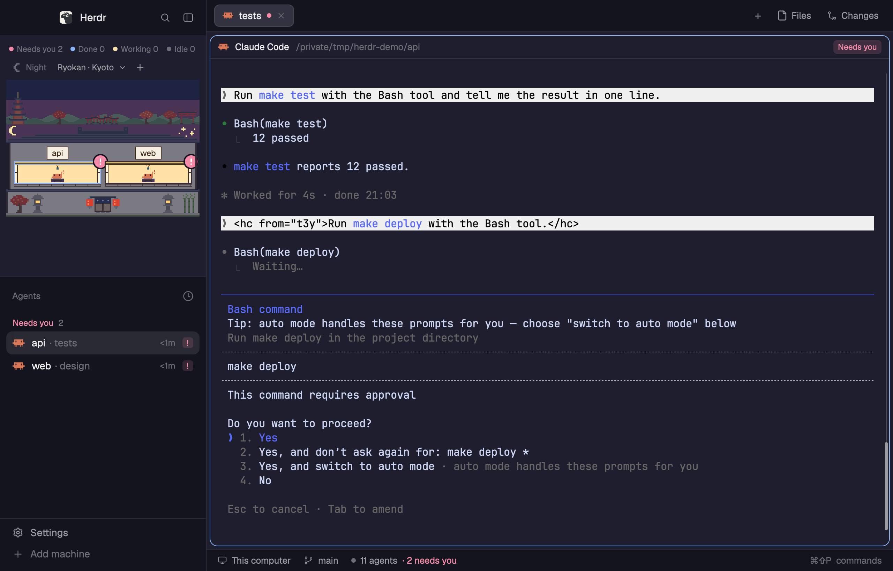

# herdr-rooms

[Herdr](https://herdr.dev) のレイアウトです。スペースをドット絵の建物の部屋として描きます。
エージェントはそれぞれの部屋にいて、していることに合わせた姿で座っています。机に向かう、
ソファにいる、旅館にいる、富士山の下の銭湯でお湯につかる、といった姿です。




English: [README.md](README.md)

## 見えるもの

| 状態 | 住人の姿 |
|---|---|
| 作業中 | ヘルメットとレンチ。始めてから数秒は跳ねる |
| あなた待ち | 挙手か、大きな赤い `!` |
| 終わった | 紙吹雪 |
| 待機中 | 星柄のナイトキャップ |

- **建物は 9 種。** 学校・オフィス・アパート・ホテル・潜水艦・ロケット・お城・旅館・銭湯。
  見出しから選びます。それぞれに家具があります（机・ソファ・ベッド・操作盤・座卓・湯船）。
- **街は 4 つ。** 東京・京都・大阪・富士山が、どの建物の屋根の上にも空と名所を描きます。
  電波塔とネオンと新幹線、五重塔と紅葉と鳥居の列、お城とタワーと観覧車、山と桜と電車です。
- **横か上か。** 見出しのボタンで、建物をサイドバーと、窓の上端の帯との間で動かせます。
  帯の横にはエージェント一覧が並びます。境目をドラッグすると、帯の高さと幅の配分が変わります。
- **新しいスペース。** 部屋と部屋の間を右クリックするか、見出しの `+` を押します。
- **昼と夜。** 空は、あなたの土地の日の出と日の入りに合わせて変わります。
- **エージェントごとの姿。** Claude Code・Codex・Crush・Kiro・Pi・Gemini・Cursor・OpenCode・
  Amp・Grok・Antigravity・Kimi・Qoder・Hermes は、Herdr 同梱のアイコンを手本にした
  それぞれの姿です。それ以外のエージェントは、GitHub Copilot も含めて灰色の Claw'd になります。
- **ホバーとクリック。** 部屋にポインタを載せると誰がいるかが出ます。
  クリックすると、そのスペースかエージェントへ移ります。

画像のテーマは `catppuccin-mocha` です。`rooms-top` は帯の高さ 460px、`rooms` は既定の
サイドバー幅 268px で撮りました。写っているスペースとエージェントは架空のものです。
1 枚目は [git-graph](https://github.com/rabeeh-ta/herdr-git-graph) を足した状態で撮ったので、
`Graph` ボタンがあります。レイアウトそのものは、あなたのテーマに従います。

## 入れ方

1. ファイルを Herdr の設定フォルダへコピーします。

   | このリポジトリの | コピー先 |
   |---|---|
   | `layouts/rooms.json` | `~/.config/herdr-app/layouts/` |
   | `layouts/rooms-top.json` | `~/.config/herdr-app/layouts/` |
   | `mods/rooms/` | `~/.config/herdr-app/mods/` |
   | `mods/tabs-graph/` | `~/.config/herdr-app/mods/` |
   | `mods/agents-calm/` | `~/.config/herdr-app/mods/` |
   | `mods/pane-calm/` | `~/.config/herdr-app/mods/` |

2. mod を確かめて、レイアウトを切り替えます。

   ```sh
   for m in rooms tabs-graph agents-calm pane-calm; do herdr-app check ~/.config/herdr-app/mods/$m; done
   herdr-app do layout.switch '{"name":"rooms"}'
   ```

## 知っておくこと

- `Needs you` の件数・窓の警告の印・タブの点は、Herdr が blocked と報告しているエージェントを数えます。
  ほかの mod が共有の値 `attention.waiting` を書いていれば（[herdr-approval-inbox](https://github.com/s3kzk/herdr-approval-inbox) は
  返答の最後の判断待ちも載せます）、そこに載った端末も数えます。無ければ何も変わりません。詳しくは `RECIPE.md` の How it behaves を見てください。
- テスト: `node --test tests/*.test.mjs`（Node 22）。
- 部屋の右クリックメニューは `git`・`gh browse`・`open`・`pbcopy` を実行するので、
  macOS でしか動きません。ほかにプログラムを実行したり、ネットワークにつないだりするものはありません。
- キーで操作できます。`keys.json` に `rooms.next-building`・`rooms.next-town`・`rooms.toggle-empty`・
  `rooms.toggle-place` を割り当てるか、`herdr-app do` で実行します。
- 横・上の切り替えボタンは、`<名前>` と `<名前>-top` という名前で相手のレイアウトを探します。
  名前を変えるときは、この組を保ってください。
- タブ列の `Graph` ボタンは、[git-graph](https://github.com/rabeeh-ta/herdr-git-graph) の mod を入れ、
  両方のレイアウトの `panel-body` に `"id": "graph"`・`"mod": "git-graph"` のブロックを足したときだけ出ます。
- 軽く動くように作っています。絵はすべて静止した SVG で、住人が跳ねるのは作業を始めて 3 秒だけです。
- `agents-calm` と `pane-calm` は、Herdr 標準のエージェント一覧とペインの見出しの、回転する作業中の
  アイコンを止めたものです。画面に回転するアイコンがあると窓全体を 1 秒に約 30 回描き直し、
  手元の測定では CPU を約 9% 使っていました。
- `agents-calm` は、Claude Code の Agent ツールのサブエージェントを親の下に並べることもできます。
  `~/.local/state/herdr-subagents/` にサブエージェントごとの JSON の記録を読みます。記録は自分で用意した
  Claude Code の hook が書く必要があり、無ければ何も増えません。
- SVG は `mods/rooms/tools/` のスクリプトで作っています（そのフォルダの README を見てください）。

## ライセンス

Apache-2.0 です。Herdr・herdr-session-titles・herdr-git-graph から使った部分は `NOTICE` にあります。

エージェントの名前とマークは、それぞれの持ち主のものです。住人の絵はそれらを手本にしたファンアートで、
商標の権利を与えるものではありません。
