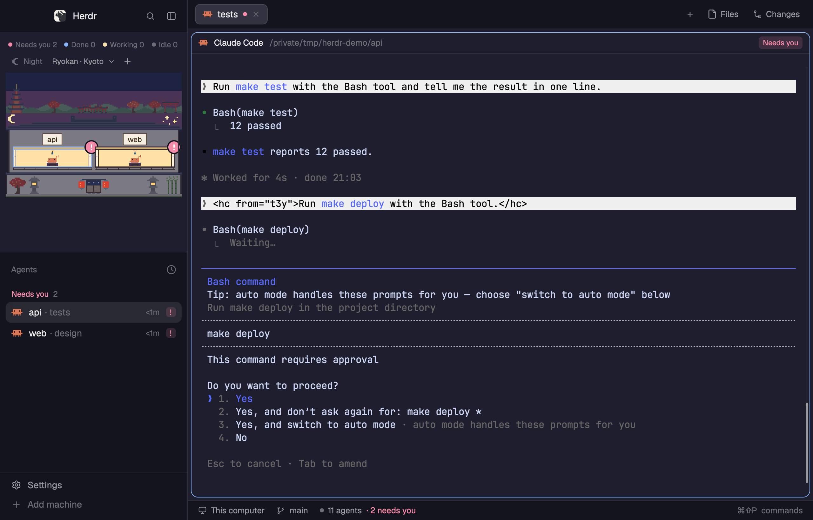

# herdr-rooms

A [Herdr](https://herdr.dev) layout that draws your spaces as rooms in a pixel-art building.
Every agent sits in its room, dressed for what it is doing: at a desk, on a sofa, in a ryokan,
or soaking in a bathhouse tub under Mount Fuji.




日本語: [README.ja.md](README.ja.md)

## What you see

| Status | The occupant |
|---|---|
| Working | Hard hat and wrench; hops for a few seconds when it starts |
| Needs you | A raised hand or a big red `!` |
| Done | Confetti |
| Idle | A starry nightcap |

- **Nine buildings.** School, office, apartment, hotel, submarine, rocket, castle,
  ryokan and sento (a Japanese bathhouse). Pick one from the header.
  Each has its own furniture: desks, a sofa, beds, consoles, low tables, bathtubs.
- **Four towns.** Tokyo, Kyoto, Osaka and Mt. Fuji paint a sky and their landmarks over
  the roof of any building: a radio tower, neon and a bullet train; a pagoda, maples and
  a row of torii; a castle, a tower and a Ferris wheel; the mountain, cherry blossoms and a train.
- **Side or top.** A button in the header moves the building between the sidebar and a
  band across the top of the window, with the agent list beside it. Drag the borders to
  change the band's height and the split.
- **New spaces.** Right-click between the rooms, or press `+` in the header.
- **Day and night.** The sky follows your local sunrise and sunset.
- **One look per agent.** Claude Code, Codex, Crush, Kiro, Pi, Gemini, Cursor, OpenCode,
  Amp, Grok, Antigravity, Kimi, Qoder and Hermes each have their own occupant,
  drawn after the icon Herdr ships for it.
  Any other agent, GitHub Copilot included, shows as a gray Claw'd.
- **Hover and click.** Hover a room to see who is in it.
  Click to jump to the space or to the agent.

The previews use the `catppuccin-mocha` theme: `rooms-top` with a 460px band, and `rooms`
with its default 268px sidebar. The spaces and agents in them are made up. The first one
was taken with [git-graph](https://github.com/rabeeh-ta/herdr-git-graph) added, which is
where its `Graph` button comes from.
The layout itself follows your theme.

## Install

1. Copy the files into your Herdr config.

   | From this repo | To |
   |---|---|
   | `layouts/rooms.json` | `~/.config/herdr-app/layouts/` |
   | `layouts/rooms-top.json` | `~/.config/herdr-app/layouts/` |
   | `mods/rooms/` | `~/.config/herdr-app/mods/` |
   | `mods/tabs-graph/` | `~/.config/herdr-app/mods/` |
   | `mods/agents-calm/` | `~/.config/herdr-app/mods/` |
   | `mods/pane-calm/` | `~/.config/herdr-app/mods/` |

2. Check the mods and switch to the layout.

   ```sh
   for m in rooms tabs-graph agents-calm pane-calm; do herdr-app check ~/.config/herdr-app/mods/$m; done
   herdr-app do layout.switch '{"name":"rooms"}'
   ```

## Good to know

- `Needs you`, the warning badge and the tab dot count agents Herdr reports as
  blocked. If a mod publishes the shared value `attention.waiting` (as
  [herdr-approval-inbox](https://github.com/s3kzk/herdr-approval-inbox) does,
  adding end-of-turn decisions), the terminals listed there count too. Without
  it nothing changes. Details in `RECIPE.md` → How it behaves.
- Tests: `node --test tests/*.test.mjs` (Node 22).
- The right-click menu on a room runs `git`, `gh browse`, `open` and `pbcopy`,
  so it works on macOS only.
  Nothing else runs programs or reaches the network.
- Keys can drive it: bind `rooms.next-building`, `rooms.next-town`, `rooms.toggle-empty`
  or `rooms.toggle-place` in `keys.json`, or run them with `herdr-app do`.
- The side/top button looks for the other layout by name: `<name>` and `<name>-top`.
  Keep that pair if you rename them.
- A `Graph` button appears in the tab bar only if you add the
  [git-graph](https://github.com/rabeeh-ta/herdr-git-graph) mod and a block with
  `"id": "graph"` and `"mod": "git-graph"` to the `panel-body` stack of both layouts.
- It is built to stay light. Every picture is a static SVG, and an occupant hops
  only for its first 3 seconds of work.
- `agents-calm` and `pane-calm` are Herdr's own agent list and pane header
  with the spinning working icon held still. A spinner on screen redraws the whole
  window about 30 times a second, which cost about 9% CPU in our measurement.
- The SVGs are generated by the scripts in `mods/rooms/tools/` (see its README).

## License

Apache-2.0. `NOTICE` lists the parts taken from Herdr, herdr-session-titles and herdr-git-graph.

Agent names and marks belong to their owners.
The occupant sprites are fan art drawn after them and grant no trademark rights.
